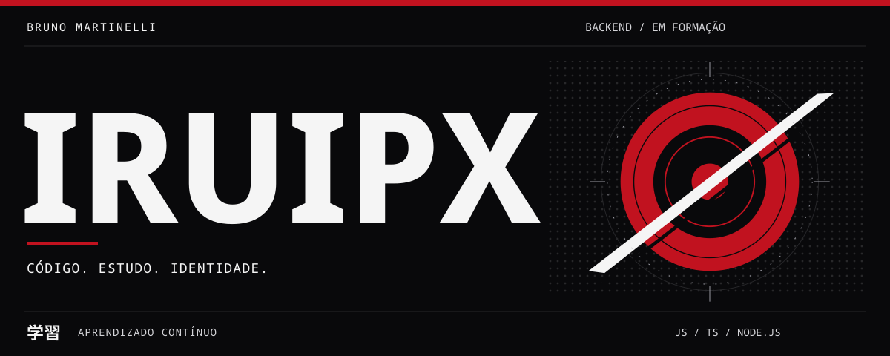
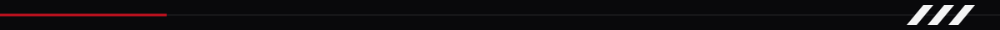
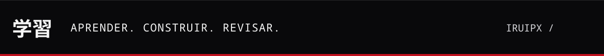

<picture>
  <source media="(max-width: 600px)" srcset="assets/header-mobile.svg">
  
</picture>

# Bruno Martinelli

Desenvolvedor júnior em formação, com foco em **backend**. Estou estudando JavaScript, TypeScript e Node.js para entender melhor o que acontece por trás de uma aplicação.

[Sobre](#01--sobre) · [Estudos](#02--em-estudo) · [Repositórios](#03--repositórios-públicos)

## 01 / Sobre

Gosto de entender como as coisas funcionam e transformar o que aprendo em prática. Meu objetivo é construir uma base sólida em backend e desenvolver projetos que eu consiga explicar, manter e melhorar.

```sh
$ cat foco.txt
backend

$ cat estudando.txt
JavaScript · TypeScript · Node.js
```

## 02 / Em estudo

<p>
  
  &nbsp;&nbsp;
  
  &nbsp;&nbsp;
  <a href="https://nodejs.org/"></a>
</p>

**JavaScript · TypeScript · Node.js**

Essas são as tecnologias que estou aprendendo. As tecnologias usadas em cada projeto serão descritas no respectivo README, conforme as implementações forem publicadas.



## 03 / Repositórios públicos

### [Senkyn ↗](https://github.com/Iruipx/Senkyn)

**Em preparação.** O repositório tem uma apresentação inicial e ainda não possui código de implementação publicado.

[Ver todos os repositórios públicos →](https://github.com/Iruipx?tab=repositories)

## 04 / Fora do código

**Tokyo Ghoul, Bleach e mangás** fazem parte do meu repertório. Gosto do contraste, da composição das páginas e de como uma imagem pode contar uma história. Essa influência também aparece por aqui.



<sub>[Créditos visuais](assets/CREDITS.md)</sub>
